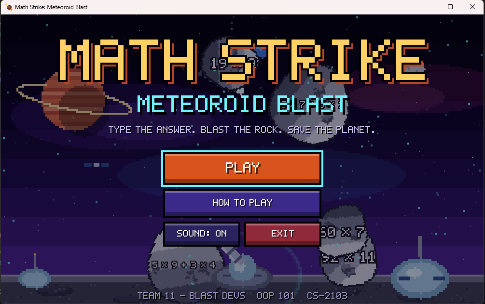
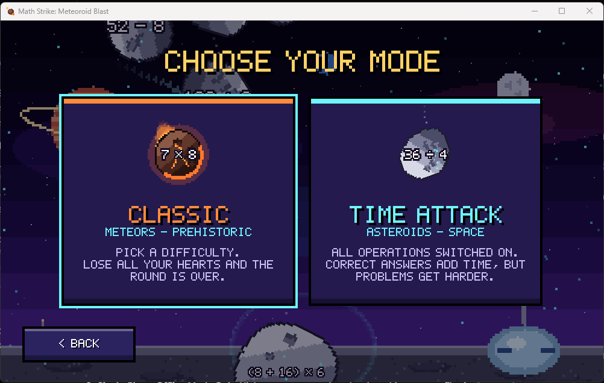
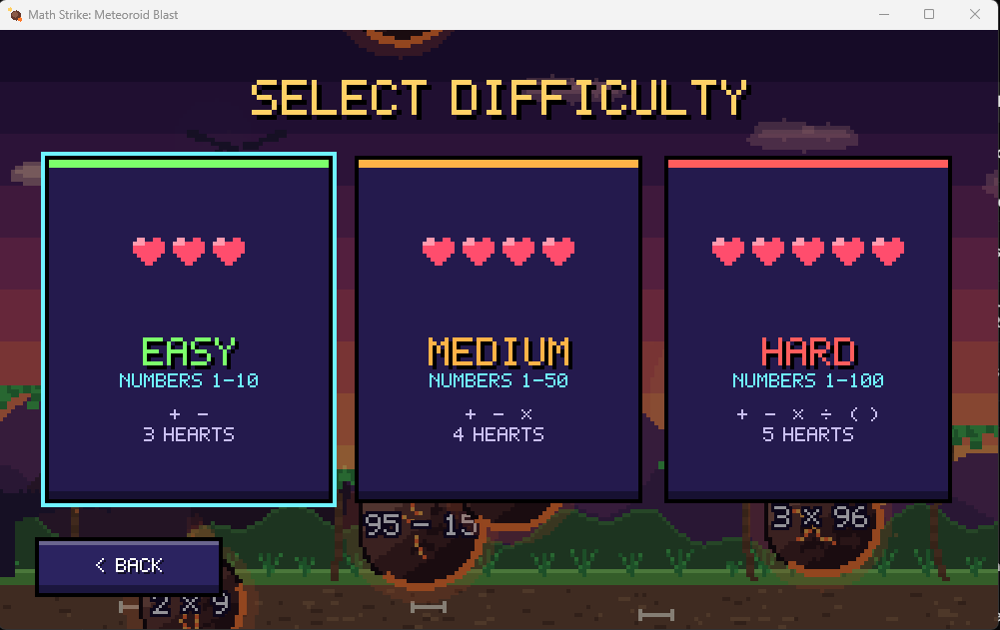
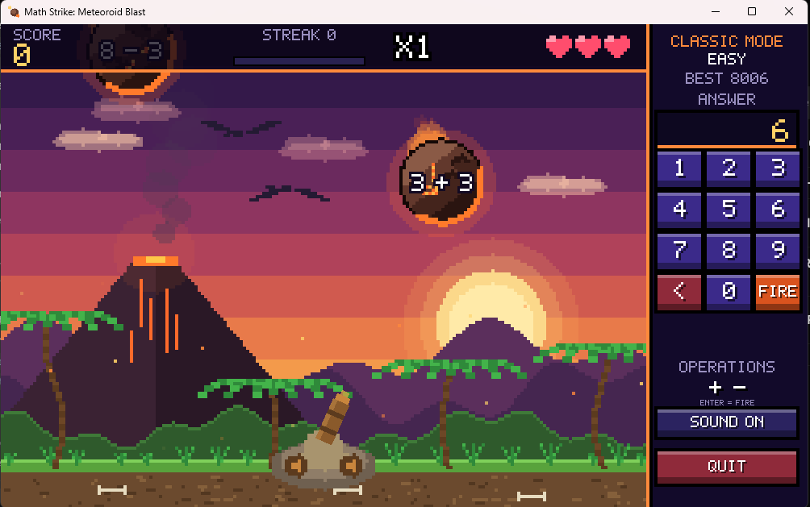
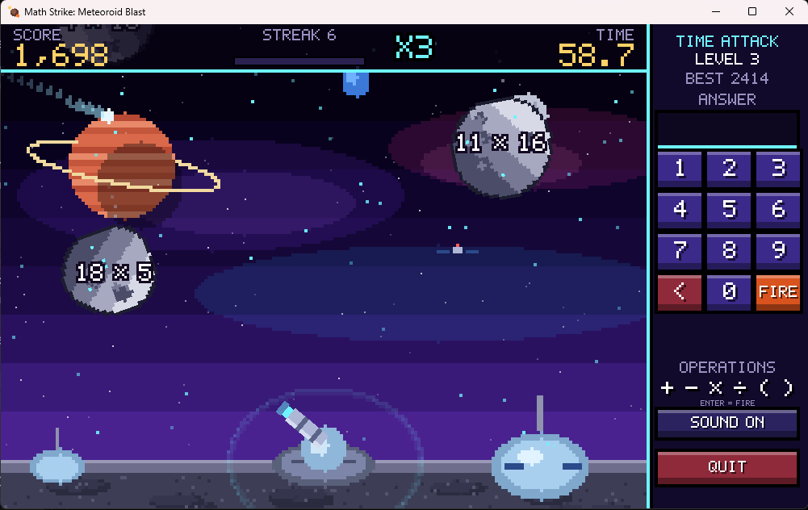
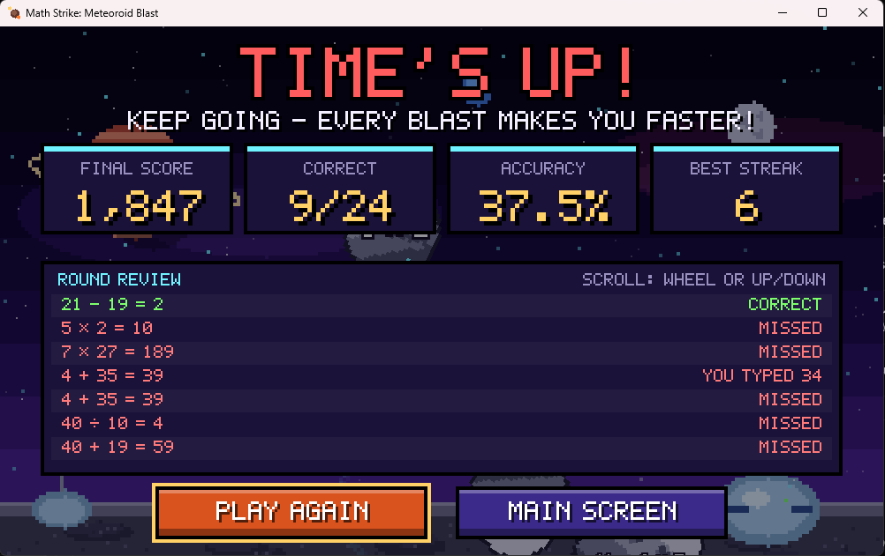

<div align="center">

# ☄️ Math Strike: Meteoroid Blast 🚀
### *Calculate Fast. Aim True. Defend the World!*

[](#7-technologies-used)
[](#7-technologies-used)
[-2ea44f?style=for-the-badge)](#7-technologies-used)
[-6f42c1?style=for-the-badge)](#8-team-members-and-roles)
[](#14-project-contributors)

<p align="center">
  <b>An action-packed, pixel-art educational arcade game built in 100% pure Java where mental math is your ultimate weapon against falling meteors and asteroids.</b>
</p>

[📖 Overview](#-2-project-description) •
[✨ Features](#-6-main-features) •
[🧱 OOP Architecture](#-9-oop-concepts-demonstrated) •
[🚀 How to Run](#-10-instructions-for-running-the-program) •
[📸 Screenshots](#-11-sample-screenshots) •
[👥 Team](#-8-team-members-and-roles)

</div>

---

## 📑 Table of Contents

1. [Project Title](#-1-project-title)
2. [Project Description](#-2-project-description)
3. [Problem Being Addressed](#-3-problem-being-addressed)
4. [Project Objectives](#-4-project-objectives)
5. [Target Users](#-5-target-users)
6. [Main Features](#-6-main-features)
7. [Technologies Used](#-7-technologies-used)
8. [Team Members and Roles](#-8-team-members-and-roles)
9. [OOP Concepts Demonstrated](#-9-oop-concepts-demonstrated)
10. [Instructions for Running the Program](#-10-instructions-for-running-the-program)
11. [Sample Screenshots](#-11-sample-screenshots)
12. [Known Limitations](#-12-known-limitations)
13. [Future Improvements](#-13-future-improvements)
14. [Project Contributors](#-14-project-contributors)

---

## 🎯 1. Project Title

**Math Strike: Meteoroid Blast**  
*Course Final Project — Object-Oriented Programming (OOP 101 / CS-2103) by **Team 11 – Blast Devs***

---

## 📖 2. Project Description

**Math Strike: Meteoroid Blast** is a desktop educational arcade game developed entirely in **pure Java (Swing/AWT)** with **zero third-party libraries, zero external image assets, and zero external audio files**. Every sprite, background animation, 5×7 pixel font glyph, particle explosion, and retro sound effect is procedurally rendered and synthesized in code.

In the game, arithmetic equations fall from the sky attached to hazardous celestial objects:
- 🌋 **Classic Mode (Prehistoric Valley):** Flaming meteors streak diagonally across an erupting volcanic landscape. Players choose between **Easy**, **Medium**, and **Hard** difficulties and defend their valley using a log cannon before running out of hearts.
- 🛸 **Time Attack Mode (Lunar Defence Base):** Tumbling rocky asteroids sway toward a lunar shield base in deep space. Players race against a 60-second countdown clock where every correct answer adds bonus time (+4s) and every 3 hits advance the level and difficulty.

Players solve the math expressions mentally, type the whole-number answer using their keyboard or the on-screen tactical keypad, and press `Enter` (or click `FIRE`) to launch a projectile and destroy the target before impact.

---

## 🧩 3. Problem Being Addressed

Many learners experience **math anxiety** and quickly lose focus when practicing mental arithmetic through traditional, repetitive drills, static flashcards, or plain text worksheets. Without immediate feedback, engaging visuals, or a sense of urgency and reward, students often:
- Struggle to build **automaticity and speed** in basic operations (`+`, `−`, `×`, `÷`, and order of operations / PEMDAS).
- Find practice tedious and disengage before mastering mental calculation accuracy.
- Lack immediate, structured post-session feedback showing specifically which problems they missed or solved under time pressure.

**Math Strike: Meteoroid Blast** addresses this problem by transforming mental arithmetic practice into an immersive, low-friction, offline arcade defense experience that rewards both **accuracy** (streak multipliers) and **calculation speed** (height-based speed bonuses), followed by a complete problem-by-problem review at the end of every round.

---

## 🎓 4. Project Objectives

1. **Gamify Mental Arithmetic:** Build an interactive arcade game that motivates players to practice addition, subtraction, multiplication, division, and multi-step order-of-operations expressions under real-time pressure.
2. **Apply Core OOP Principles in Java:** Design a clean, modular, and extensible Object-Oriented architecture that concretely demonstrates **Abstraction**, **Encapsulation**, **Inheritance**, **Polymorphism**, and **Custom Exception Handling**.
3. **Deliver Adaptive & Progressive Challenge:** Provide distinct gameplay experiences through selectable difficulty tiers (**Easy**, **Medium**, **Hard**) in Classic Mode and dynamic level scaling in **Time Attack Mode**.
4. **Provide Actionable Learning Feedback:** Track player score, streak multipliers, calculation accuracy percentage, local high scores, and a full end-of-round **Answer Review Table** comparing the player's input against the correct answer.
5. **Ensure Zero-Dependency Portability:** Package the entire game—including procedural pixel art, custom bitmap typography, and real-time PCM audio synthesis—into a single, self-contained executable JAR that runs offline on any computer with JDK 17+.

---

## 🧑‍🎓 5. Target Users

| Target Group | How They Benefit |
| :--- | :--- |
| **Elementary & High School Students** | Practice fundamental arithmetic (`+`, `−`, `×`, `÷`) and order of operations (`(a + b) × c`) in an exciting game environment instead of static worksheets. |
| **College Students & Casual Gamers** | Sharpen mental calculation speed, working memory, and reflex accuracy through fast-paced Time Attack sessions and high-score chasing. |
| **Teachers & Educators** | Use as an offline, zero-setup classroom warm-up or math station tool (single `.jar` file, no internet or installation required). |
| **Introductory OOP / Java Learners** | Study a well-structured, pure-JDK codebase illustrating abstract classes, polymorphic game loops, custom exceptions, Java records, and Swing custom rendering. |

---

## ✨ 6. Main Features

### 🎮 Two Distinct Game Modes & Worlds
| Mode | World & Theme | Target Type | Core Rules |
| :--- | :--- | :--- | :--- |
| **Classic Mode** | **Prehistoric Valley** *(dusk sky, erupting volcano, lava fountain, pterodactyls, walking brontosaurus, fireflies, log cannon)* | **Meteors** *(diagonal drift, wall-bouncing, flame tails, fireball explosions)* | Pick **Easy** (3 hearts), **Medium** (4 hearts), or **Hard** (5 hearts). Wrong answers or ground impacts cost `1 heart`. Speed ramps up as you score. |
| **Time Attack** | **Lunar Defence Base** *(nebula sky, ringed planet, 3-layer parallax stars, comet, blinking satellite, energy shield, laser turret)* | **Asteroids** *(sinusoidal sway, rotating rock sprites, dust trails, rocky debris explosions)* | Start with `60s`. Correct answers grant `+4s` (up to `99s`); misses/wrong answers cost `-2s`. Every `3` hits increase the **Level**, number range, and fall speed. |

### 🧮 Dynamic Math Problem Generator
- **Guaranteed Fair Mental Math:** All answers are positive whole numbers. Division problems are constructed in reverse (`a = b × q`) so quotients are always exact whole numbers with zero remainders. Multiplication and division cap one factor at `12` (`TABLE_LIMIT = 12`) to keep mental math fair even at high ranges.
- **Difficulty Progression:**

| Difficulty / Tier | Number Range | Operators Included | Order of Operations | Starting Hearts | Base Fall Time |
| :--- | :---: | :---: | :---: | :---: | :---: |
| **Easy** *(Classic)* | `1 – 10` | `+`, `−` | No | ❤️❤️❤️ (3) | `14.0s` |
| **Medium** *(Classic)* | `1 – 50` | `+`, `−`, `×` | No | ❤️❤️❤️❤️ (4) | `11.0s` |
| **Hard** *(Classic)* | `1 – 100` | `+`, `−`, `×`, `÷` | Yes *(25% multi-step expressions)* | ❤️❤️❤️❤️❤️ (5) | `9.0s` |
| **Time Attack** *(Lvl 1 → 10+)* | `1 – 10` up to `1 – 100` | Scales from `+ −` to `+ − × ÷ ( )` | Unlocked at Level 5+ *(25%–30%)* | ⏱️ `60s` Timer | `12.0s` down to `6.0s` |

### 🏆 Arcade Scoring, Streaks & Post-Round Analytics
- **Speed Bonus + Streak Multiplier:** Each destroyed target awards `100` base points plus up to `50` speed bonus points (based on how high in the sky the target was blasted), multiplied by the current streak multiplier (`x1` → `x2` at 3 streak → `x3` at 6 → `x4` at 9 → `x5` at 12+).
- **Lowest-Target Priority:** If two falling targets happen to share the same numerical answer, the defense turret automatically locks onto and blasts the **lowest (most dangerous)** target first.
- **Non-Punitive Input Validation:** Empty submissions, accidental letters, or out-of-range inputs are caught by `InputValidator` and display a helpful prompt (`"Type a number first!"`) **without** costing a heart or resetting the player's streak.
- **Comprehensive Results Screen:** Displays Final Score, Personal Best badge (`java.util.prefs`), Correct / Total count, Accuracy %, Best Streak, custom congratulatory feedback, and a **scrollable problem-by-problem review log** (`CORRECT`, `WRONG`, `MISSED`).

### 🎨 100% Procedural Graphics & Synthesized Retro Audio
- **Custom 5×7 Bitmap Pixel Font (`PixelFont`):** Crisp retro typography rendered at any integer scale without relying on system fonts.
- **Visual Polish (`Effects`):** Screen shake on impact, red danger vignette on last heart or final 10 seconds, floating score popups, laser beams, and particle explosions.
- **Procedural PCM Audio (`Sound`):** Synthesizes square-wave, triangle-wave, and low-pass filtered noise sound effects (`shoot`, `boom`, `impact`, `wrong`, `good`, `streak`, `tick`, `go`, `gameover`, `click`) directly in memory via `javax.sound.sampled`.

---

## 🛠️ 7. Technologies Used

| Category | Technology / Tool | Purpose in Project |
| :--- | :--- | :--- |
| **Programming Language** | **Java (JDK 17+)** | Core application logic, OOP hierarchy, records (`AnswerRecord`, `GameEvent`), and enums (`Difficulty`). |
| **GUI & Rendering** | **Java Swing & AWT** (`javax.swing`, `java.awt`) | Custom 60 FPS game loop (`javax.swing.Timer`), hardware-scaled `1000×600` off-screen `BufferedImage` canvas, keyboard & mouse listeners. |
| **Audio Synthesis** | **Java Sound API** (`javax.sound.sampled`) | Real-time procedural 16-bit 22,050 Hz PCM sound effect generation with 3-voice polyphony—no external `.wav` or `.mp3` files. |
| **Local Persistence** | **Java Preferences API** (`java.util.prefs.Preferences`) | Persists local personal-best high scores per game mode and difficulty across sessions. |
| **Build & Packaging** | **Batch (`build.bat`) & Shell (`build.sh`)** | Dependency-free compilation (`javac`) and executable archive packaging (`jar cfm MathStrike.jar`). |
| **Automated Testing** | **Custom Headless Test Suite** (`SelfTest`, `UiSmoke`) | 250,000+ automated math rule assertions and headless UI smoke testing with automated PNG screenshot capture. |
| **Architecture Modeling** | **Mermaid.js & PlantUML** (`docs/class-diagram.*`) | Complete UML Class Diagram documenting all classes, relationships, and visibility modifiers. |

---

## 👥 8. Team Members and Roles

**Team 11 – Blast Devs (CS-2103)**

| Team Member | Role / Focus Area | Key Responsibilities & Owned Components |
| :--- | :--- | :--- |
| **Drancel Rosales** | **Team Lead / Game Engine & Core Architecture** | Designed overall game loop and state machine (`Game`, `GamePanel`, `MathStrike`), target hierarchy (`Target`, `Meteor`, `Asteroid`), collision & targeting logic, build packaging, and system integration. |
| **Ally** | **Math Logic, Game Modes & Exception Handling** | Implemented arithmetic rule engine and expression generator (`Problem`, `Difficulty`, `ProblemGenerator`), polymorphic game modes (`GameMode`, `ClassicMode`, `TimeAttackMode`), and input validation (`InputValidator`, `InvalidAnswerException`). |
| **Jian** | **UI Scenes, Scoring Analytics & Audio/Visual Effects** | Built scene navigation and interactive screens (`Scene`, `TitleScene`, `ChoiceScene`, `TextScene`, `PlayScene`, `ResultsScene`), scoring & accuracy tracking (`ScoreManager`, `Health`, `AnswerRecord`, `HighScores`), procedural themes (`Theme`, `PrehistoricTheme`, `SpaceTheme`), and effects (`Effects`, `Sound`, `Sprites`, `PixelFont`). |

---

## 🧱 9. OOP Concepts Demonstrated

Our codebase is structured around the four pillars of Object-Oriented Programming plus defensive exception handling and Java collections:

### 1. Abstraction
Complex subsystems define high-level contracts through `abstract` classes so callers interact with *what* an object does rather than *how* it does it:
- **`Target` (`abstract class`):** Declares abstract methods `move(double dt)`, `draw(Graphics2D g, double time)`, and `explode(Effects fx, boolean big)`. The `Game` loop updates and checks ground collisions on `Target` without knowing whether it is a fiery meteor or a spinning asteroid.
- **`GameMode` (`abstract class`):** Defines the rule lifecycle (`start()`, `update(double dt)`, `onCorrect(...)`, `onMiss(...)`, `isGameOver()`, `nextProblem()`, and factory method `createTarget(Problem)`).
- **`Theme` & `Scene` (`abstract class`):** Abstract visual world rendering (`paintBackdrop`, `paintAnimated`, `drawTurret`) and screen lifecycle (`update`, `paint`, keyboard/mouse handlers).

### 2. Encapsulation
All domain state is kept strictly `private` (or `protected` only where needed by subclasses) and mutated exclusively through validated methods:
- **`ScoreManager`:** Fields `score`, `streak`, `bestStreak`, `correct`, `total`, and `records` are `private`. External classes cannot arbitrarily edit the score; they must call `recordCorrect(record, heightRatio)` or `recordMiss(record)`, and `addScore(int)` enforces `score = Math.max(0, score + points)` so scores never become negative.
- **`Health`:** Encapsulates `hearts` and `maxHearts`, exposing only `loseHeart()`, `getHearts()`, `getMaxHearts()`, and `isDead()`.
- **`Problem` & `Difficulty`:** `Problem` is immutable (`private final String question; private final int answer;`). `Difficulty` encapsulates operator arrays and clones them in `getOperators()` (`return operators.clone();`) to prevent external mutation.

### 3. Inheritance
Specialized subclasses extend base classes to reuse shared attributes while customizing behavior:
- `Meteor` and `Asteroid` **extend** `Target` (inheriting `id`, `problem`, `speed`, `radius`, `x`, `y`, `hasReachedGround()`, and `drawLabel()`).
- `ClassicMode` and `TimeAttackMode` **extend** `GameMode` (inheriting `ScoreManager`, `ProblemGenerator`, and `Random`).
- `PrehistoricTheme` and `SpaceTheme` **extend** `Theme`.
- `TitleScene`, `ChoiceScene`, `TextScene`, `PlayScene`, and `ResultsScene` **extend** `Scene`.

### 4. Polymorphism
At runtime, `Game` and `PlayScene` operate on base references (`GameMode`, `List<Target>`, `Theme`, `Scene`) and invoke overridden methods dynamically:
- **Movement & Explosion Polymorphism:** Calling `target.move(dt)` makes a `Meteor` drift diagonally and bounce off screen edges, whereas an `Asteroid` oscillates horizontally along a sine wave (`Math.sin`) and rotates its sprite. Calling `target.explode(fx, big)` triggers `fx.fireball(...)` for a `Meteor` and `fx.debris(...)` for an `Asteroid`.
- **Rule & Factory Polymorphism:** Calling `mode.createTarget(problem)` returns a `new Meteor(...)` in `ClassicMode` and a `new Asteroid(...)` in `TimeAttackMode`. Calling `mode.onMiss(rec)` deducts a heart in `ClassicMode` (`health.loseHeart()`) but deducts 2 seconds in `TimeAttackMode` (`timeLeft - MISS_PENALTY`).

### 5. Exception Handling & Collections
- **Custom Checked Exception (`InvalidAnswerException`):** `InputValidator.parseAnswer(String raw)` throws `InvalidAnswerException` when input is empty, non-numeric, negative, or exceeds 6 digits. `Game.checkAnswer()` catches it gracefully and displays a message without penalizing the player.
- **Graceful Degradation:** `HighScores` wraps OS `Preferences` access in `try-catch (RuntimeException)` and `Sound` catches audio hardware exceptions so headless or audio-less machines never crash.
- **Collections & Arrays:** Uses `List<Target>` (`ArrayList`) with safe `Iterator<Target>` removal during the game loop, `List<AnswerRecord>` converted to `AnswerRecord[]` for results reporting, and `Map<String, Clip[]>` (`HashMap`) for audio clip pooling.

### 📐 UML Class Diagram

> Full diagram sources are available in [`docs/class-diagram.mmd`](docs/class-diagram.mmd) and [`docs/class-diagram.puml`](docs/class-diagram.puml).

```mermaid
classDiagram
    direction TB

    %% ==========================================
    %% 1. CORE MATH & DATA MODELS
    %% ==========================================
    class Problem {
        -String question
        -int answer
        +Problem(String question, int answer)
        +getQuestion() String
        +getAnswer() int
        +isCorrect(int guess) boolean
    }

    class Difficulty {
        <<enumeration>>
        EASY
        MEDIUM
        HARD
        -String label
        -int min
        -int max
        -char[] operators
        -int hearts
        -double seconds
        -double spawnSeconds
        -boolean orderOfOperations
        +getLabel() String
        +getMin() int
        +getMax() int
        +getOperators() char[]
        +getHearts() int
        +getSeconds() double
        +getSpawnSeconds() double
        +usesOrderOfOperations() boolean
        +fromString(String s)$ Difficulty
    }

    class ProblemGenerator {
        -int TABLE_LIMIT$
        -Random random
        -Difficulty current
        +ProblemGenerator(Random random, Difficulty difficulty)
        +setDifficulty(Difficulty difficulty) void
        +getDifficulty() Difficulty
        +generate() Problem
        +generateForLevel(int level) Problem
        +basic(int min, int max, char op) Problem
        +expression(int max) Problem
    }

    class InputValidator {
        -int MAX_DIGITS$
        +parseAnswer(String raw)$ int
    }

    class InvalidAnswerException {
        <<exception>>
        +InvalidAnswerException(String message)
    }

    class AnswerRecord {
        <<record>>
        +String question
        +String given
        +int correctAnswer
        +Outcome outcome
    }

    class GameEvent {
        <<record>>
        +String type
        +double x
        +double y
        +String text
        +String tone
        +Target target
    }

    %% ==========================================
    %% 2. TARGET HIERARCHY (INHERITANCE & POLYMORPHISM)
    %% ==========================================
    class Target {
        <<abstract>>
        +int WORLD_WIDTH$
        +int WORLD_HEIGHT$
        +int GROUND_Y$
        -int id
        -Problem problem
        -double speed
        -int radius
        #double x
        #double y
        #Target(Problem problem, double speed)
        +getId() int
        +getProblem() Problem
        +getX() double
        +getY() double
        +getSpeed() double
        +getRadius() int
        +placeAt(double newX) void
        +setY(double newY) void
        +move(double dt)* void
        +draw(Graphics2D g, double time)* void
        +explode(Effects fx, boolean big)* void
        +hasReachedGround() boolean
        #drawLabel(Graphics2D g) void
    }

    class Meteor {
        -double drift
        +Meteor(Problem problem, double speed, Random random)
        +move(double dt) void
        +draw(Graphics2D g, double time) void
        +explode(Effects fx, boolean big) void
    }

    class Asteroid {
        -double amplitude
        -double frequency
        -double phase
        -double spin
        -double baseX
        -double age
        -double angle
        +Asteroid(Problem problem, double speed, Random random)
        +placeAt(double newX) void
        +move(double dt) void
        +draw(Graphics2D g, double time) void
        +explode(Effects fx, boolean big) void
    }

    %% ==========================================
    %% 3. GAME MODES, HEALTH, SCORING & ENGINE
    %% ==========================================
    class Health {
        -int maxHearts
        -int hearts
        +Health(int hearts)
        +loseHeart() void
        +getHearts() int
        +getMaxHearts() int
        +isDead() boolean
    }

    class ScoreManager {
        +int BASE_POINTS$
        +int MAX_MULTIPLIER$
        -int score
        -int streak
        -int bestStreak
        -int correct
        -int total
        -List~AnswerRecord~ records
        +getMultiplier() int
        +recordCorrect(AnswerRecord record, double heightRatio) int
        +addScore(int points) void
        +recordMiss(AnswerRecord record) void
        +getScore() int
        +getStreak() int
        +getBestStreak() int
        +getCorrect() int
        +getTotal() int
        +getAccuracy() double
        +getCongratulation() String
        +getRecords() AnswerRecord[]
    }

    class HighScores {
        -Preferences PREFS$
        +get(String key)$ int
        +submit(String key, int score)$ boolean
    }

    class GameMode {
        <<abstract>>
        #ScoreManager score
        #ProblemGenerator generator
        #Random random
        #GameMode(Random random, ProblemGenerator generator)
        +getScore() ScoreManager
        +getKey()* String
        +getName()* String
        +getTheme()* String
        +getSubtitle()* String
        +start()* void
        +update(double dt)* void
        +onCorrect(AnswerRecord record, double heightRatio)* int
        +onMiss(AnswerRecord record)* void
        +isGameOver()* boolean
        +nextProblem()* Problem
        +createTarget(Problem problem)* Target
        +getSpawnInterval()* double
        +getMaxTargets()* int
        +getHearts() int
        +getMaxHearts() int
        +getTimeLeft() double
        +getLevel() int
        +getBonusSeconds() double
    }

    class ClassicMode {
        -Difficulty difficulty
        -Health health
        +ClassicMode(Random random, Difficulty difficulty)
        +getKey() String
        +getName() String
        +getTheme() String
        +getSubtitle() String
        +start() void
        +update(double dt) void
        +onCorrect(AnswerRecord record, double heightRatio) int
        +onMiss(AnswerRecord record) void
        +isGameOver() boolean
        +nextProblem() Problem
        +createTarget(Problem problem) Target
        +getSpawnInterval() double
        +getMaxTargets() int
        +getHearts() int
        +getMaxHearts() int
    }

    class TimeAttackMode {
        +double START_SECONDS$
        +double MAX_SECONDS$
        +double MISS_PENALTY$
        -double timeLeft
        -int level
        -double bonusSeconds
        +TimeAttackMode(Random random)
        +getKey() String
        +getName() String
        +getTheme() String
        +getSubtitle() String
        +start() void
        +update(double dt) void
        +onCorrect(AnswerRecord record, double heightRatio) int
        +onMiss(AnswerRecord record) void
        +isGameOver() boolean
        +nextProblem() Problem
        +createTarget(Problem problem) Target
        +getSpawnInterval() double
        +getMaxTargets() int
        +getTimeLeft() double
        +getLevel() int
        +getBonusSeconds() double
    }

    class Game {
        -GameMode mode
        -Random random
        -List~Target~ targets
        -List~GameEvent~ events
        -Phase phase
        -double readyLeft
        -double spawnTimer
        +Game(GameMode mode, Random random)
        +start() void
        +update(double dt) void
        +spawnTarget() void
        +checkAnswer(String raw) boolean
        +endRound() void
        +getMode() GameMode
        +getPhase() Phase
        +getTargets() List~Target~
        +drainEvents() List~GameEvent~
    }

    %% ==========================================
    %% 4. VISUAL THEMES, EFFECTS & SOUND
    %% ==========================================
    class Theme {
        <<abstract>>
        +int HEIGHT$
        #int P$
        #int GROUND$
        -BufferedImage cache
        +of(String key)$ Theme
        +getName()* String
        +getAccent()* Color
        +getBeamColor()* Color
        #paintStatic(Graphics2D g, int width)* void
        +paintAnimated(Graphics2D g, double t, int width)* void
        +drawTurret(Graphics2D g, double aim, double recoil, double t)* void
        +muzzle(double aim, double recoil) double[]
        +paintBackdrop(Graphics2D g, double t, int width) void
    }

    class PrehistoricTheme {
        +getName() String
        +getAccent() Color
        +getBeamColor() Color
        #paintStatic(Graphics2D g, int w) void
        +paintAnimated(Graphics2D g, double t, int w) void
        +drawTurret(Graphics2D g, double aim, double recoil, double t) void
    }

    class SpaceTheme {
        -double[][][] stars
        +getName() String
        +getAccent() Color
        +getBeamColor() Color
        #paintStatic(Graphics2D g, int w) void
        +paintAnimated(Graphics2D g, double t, int w) void
        +drawTurret(Graphics2D g, double aim, double recoil, double t) void
    }

    class Effects {
        +fireball(double x, double y, int radius, boolean big) void
        +debris(double x, double y, int radius, boolean big) void
        +spark(double x, double y, double vx, double vy, Color color, double life) void
        +beam(double x0, double y0, double x1, double y1, Color color) void
        +ring(double x, double y, Color color) void
        +scar(double x) void
        +floatText(String text, double x, double y, double vy, double life, Color color, int scale) void
        +feedback(String text, String tone) void
        +shake(double seconds) void
        +flash(double seconds) void
        +update(double dt) void
        +paintScars(Graphics2D g) void
        +paint(Graphics2D g) void
    }

    class Sprites {
        +rock(Target t)$ BufferedImage
        +label(Target t)$ BufferedImage
        +prune(Set~Integer~ aliveIds)$ void
        +clear()$ void
    }

    class PixelArt {
        +int P$
        +snap(double v)$ int
        +rect(Graphics2D g, double x, double y, double w, double h, Color color)$ void
        +ellipse(Graphics2D g, double cx, double cy, double rx, double ry, Color color)$ void
        +disc(Graphics2D g, double cx, double cy, double r, Color color)$ void
        +ring(Graphics2D g, double cx, double cy, double rx, double ry, Color color)$ void
    }

    class PixelFont {
        +width(String text, int scale)$ int
        +height(int scale)$ int
        +draw(Graphics2D g, String text, int x, int y, int scale, Color color)$ void
        +centered(Graphics2D g, String text, int cx, int y, int scale, Color color)$ void
        +render(String text, int scale, Color fg, Color bg)$ BufferedImage
    }

    class Sound {
        +isEnabled()$ boolean
        +setEnabled(boolean on)$ void
        +play(String name)$ void
    }

    %% ==========================================
    %% 5. UI SCENES & DESKTOP ENTRY POINT
    %% ==========================================
    class Scene {
        <<abstract>>
        #GamePanel app
        #List~Button~ buttons
        #int focus
        #Scene(GamePanel app)
        +update(double dt) void
        +paint(Graphics2D g, double t)* void
        +mouseMoved(int x, int y) void
        +mousePressed(int x, int y) void
        +mouseWheel(int rotation) void
        +keyTyped(char c) void
        +keyPressed(KeyEvent e) void
    }

    class TitleScene {
        -Backdrop backdrop
        +TitleScene(GamePanel app)
        +update(double dt) void
        +paint(Graphics2D g, double t) void
    }

    class ChoiceScene {
        -Backdrop backdrop
        -String title
        +ChoiceScene(GamePanel app, Theme theme, String title, List~Choice~ choices, Runnable back)
        +update(double dt) void
        +paint(Graphics2D g, double t) void
    }

    class TextScene {
        -Backdrop backdrop
        -String title
        -int page
        +TextScene(GamePanel app, Theme theme, String title, List pages, String primaryLabel, Runnable primary, Runnable back)
        +update(double dt) void
        +paint(Graphics2D g, double t) void
    }

    class PlayScene {
        -Game game
        -GameMode mode
        -Theme theme
        -Effects fx
        -Button[] keypad
        +PlayScene(GamePanel app, Game game, String modeKey, Difficulty difficulty)
        +update(double dt) void
        +paint(Graphics2D g, double t) void
    }

    class ResultsScene {
        -Game game
        -ScoreManager score
        -Backdrop backdrop
        -AnswerRecord[] records
        +ResultsScene(GamePanel app, Game game, boolean newBest)
        +update(double dt) void
        +paint(Graphics2D g, double t) void
    }

    class Backdrop {
        -Theme theme
        -List~Target~ targets
        -Effects fx
        +Backdrop(Theme theme, boolean cannon)
        +update(double dt) void
        +paint(Graphics2D g, double t) void
    }

    class Button {
        +Rectangle bounds
        +String label
        +Runnable action
        +paint(Graphics2D g, double t) void
        +contains(int x, int y) boolean
    }

    class GamePanel {
        +int W$
        +int H$
        -Scene scene
        -Timer timer
        +GamePanel(Runnable exitAction)
        +start() void
        +tick(double dt) void
        +renderFrame() BufferedImage
        +showTitle() void
        +showModes() void
        +showDifficulty() void
        +showHowTo() void
        +showBriefing() void
        +startGame() void
        +playAgain() void
        +showResults(Game game, boolean newBest, String key) void
        +exit() void
    }

    class MathStrike {
        +main(String[] args)$ void
    }

    %% ==========================================
    %% RELATIONSHIPS
    %% ==========================================
    Target <|-- Meteor
    Target <|-- Asteroid
    Target *-- Problem

    GameMode <|-- ClassicMode
    GameMode <|-- TimeAttackMode
    GameMode *-- ScoreManager
    GameMode *-- ProblemGenerator
    ClassicMode *-- Health
    ClassicMode --> Difficulty
    ClassicMode ..> Meteor : creates
    TimeAttackMode ..> Asteroid : creates

    ProblemGenerator --> Difficulty
    ProblemGenerator ..> Problem : creates
    ScoreManager *-- AnswerRecord

    Game *-- GameMode
    Game o-- Target
    Game *-- GameEvent
    Game ..> InputValidator : uses
    InputValidator ..> InvalidAnswerException : throws

    Theme <|-- PrehistoricTheme
    Theme <|-- SpaceTheme

    Scene <|-- TitleScene
    Scene <|-- ChoiceScene
    Scene <|-- TextScene
    Scene <|-- PlayScene
    Scene <|-- ResultsScene
    Scene o-- Button

    TitleScene *-- Backdrop
    ChoiceScene *-- Backdrop
    TextScene *-- Backdrop
    ResultsScene *-- Backdrop
    Backdrop --> Theme

    PlayScene *-- Game
    PlayScene --> Theme
    PlayScene *-- Effects
    PlayScene ..> HighScores : uses
    PlayScene ..> Sound : uses

    MathStrike ..> GamePanel : creates
    GamePanel *-- Scene
    Target ..> Sprites : uses
    Sprites ..> PixelArt : uses
    Sprites ..> PixelFont : uses
```



---

## 🚀 10. Instructions for Running the Program

### Prerequisites
- **Java Development Kit (JDK) 17 or newer** installed on your system.
- Verify your installation by running:
  ```bash
  java -version
  javac -version
  ```

### Option A: Quick Start (Run Pre-Built JAR)
Because the repository includes the pre-packaged `MathStrike.jar`, you can launch the game immediately from the project root:
```bash
java -jar MathStrike.jar
```

### Option B: Compile & Run from Source (Windows)
```cmd
build.bat
java -jar MathStrike.jar
```

### Option C: Compile, Run & Execute Automated Tests (Linux / macOS / Git Bash)
```bash
./build.sh run     # Compiles all sources, builds MathStrike.jar, and launches the game
./build.sh test    # Runs 250,000+ math rule self-tests (SelfTest)
```

### 🎮 Controls Reference
| Input | In-Game Action |
| :--- | :--- |
| **`0` – `9` Keys** or **On-Screen Keypad** | Type your numerical answer |
| **`Enter`** or **`FIRE` Button** | Fire cannon / laser turret at matching target |
| **`Backspace`** or **`<` Button** | Delete the last digit |
| **`Esc`** | Open Quit Confirmation during gameplay / Go back in menus |
| **`Arrow Keys` + `Enter`** or **Mouse Click** | Navigate menu cards and buttons |
| **`M`** *(in menus)* | Toggle synthesized retro sound effects On / Off |

---

## 📸 11. Sample Screenshots
> *All screenshots below are captured directly from the live `1000×600` game renderer.*
| **1. Title Screen (`TitleScene` — Animated Space Backdrop)** | **2. Game Mode Selection (`ChoiceScene` — Classic vs. Time Attack)** |
| :---: | :---: |
|  |  |
| **3. Classic Mode — Difficulty Selection (`Easy`, `Medium`, `Hard`)** | **4. Classic Mode — Prehistoric Valley Gameplay (`PlayScene`)** |
|  |  |
| **5. Time Attack — Lunar Defence Base Gameplay (`PlayScene`)** | **6. Post-Round Results & Scrollable Answer Review (`ResultsScene`)** |
|  |  |

---

## ⚠️ 12. Known Limitations

In accordance with our project scope and proposal boundaries:
1. **Positive Whole-Number Answers Only:** Problems and input validation are intentionally restricted to positive integers (`> 0`). Fractions, decimals, and negative results are excluded so gameplay remains fast-paced and accessible via a simple digit keypad.
2. **Single-Player Offline Mode Only:** High scores are saved per local machine user profile via `java.util.prefs.Preferences`; there are no cloud accounts, online leaderboards, or multiplayer modes.
3. **No Mid-Round Pause or Save-State:** Pressing `Esc` prompts the player to confirm quitting the active round (`Y / N`), which returns to the Title Screen without saving the incomplete round.
4. **Desktop Keyboard / Mouse Input Only:** Designed for desktop/laptop screens (`1000×600` logical aspect ratio, resizable window) without voice recognition or mobile touch packaging.

---

## 🔮 13. Future Improvements

1. **Additional Math Topics & Custom Practice Decks:** Add optional modes for fractions, decimals, negative integers, exponents, and algebraic solving (`2x + 5 = 17`), plus a teacher-configurable custom problem range.
2. **Power-Ups & Boss Meteors:** Introduce special targets that grant temporary abilities when solved (e.g., *Cryo-Freeze* to slow falling targets, *Shield Repair* to restore 1 heart, or *Multi-Blast* to clear the screen) and giant multi-hit Boss Asteroids.
3. **Player Profiles & Exportable Progress Reports:** Allow multiple named student profiles on the same computer with historical accuracy charts and CSV/PDF report exports for teachers or parents.
4. **Local Co-Op & LAN Versus Mode:** Add a 2-player split-screen or local network mode where solving streaks send faster meteors to the opponent's screen.
5. **Pause Menu & Custom Keybindings:** Allow pausing mid-round (while hiding the math equations on screen so players cannot cheat the timer) and customizable audio/accessibility settings.

---

## 🤝 14. Project Contributors

Built with passion for **OOP 101 (CS-2103)** by **Team 11 – Blast Devs**:

- 👨‍💻 **Drancel Rosales** — *Game Loop, Target Physics & Core Engine Architecture*
- 👩‍💻 **Ally** — *Math Problem Generation, Game Modes & Exception Handling*
- 👨‍💻 **Jian** — *UI Scenes, Scoring Analytics, Procedural Worlds & Audio/Visual Effects*

---

<div align="center">
  <sub>© 2026 Team 11 – Blast Devs (CS-2103) · 100% Pure Java (Swing/AWT) · Math Strike: Meteoroid Blast</sub>
</div>
